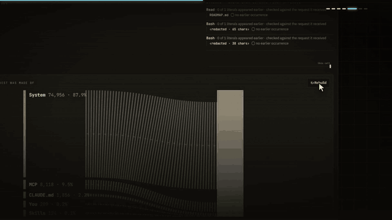

<p align="center"></p>

<p align="center"><b>Can you trust this coding-agent telemetry, and what does it fail to tell you?</b></p>

<p align="center">
  <a href="https://github.com/1Ash0/assay/actions/workflows/check.yml"></a>
  
  
  
</p>

<p align="center"></p>

**[Open the live explorer →](https://1ash0.github.io/assay/)** (real, redacted sessions; nothing to install)

assay reads Claude Code sessions and answers that question before it answers anything else. Every run gets:

- **a Capture Level**, stated before any number: L1 transcript, L2 hooks, L3 OTel, L4 raw API bodies;
- **a truth label**: `real`, `real-perturbed` or `scripted`, on every run and figure;
- **14 detectors** (D0–D12 and D-cost) that check the data against itself, each finding pointing at the exact bytes it came from.

Then it rebuilds what the model was actually sent, proves the rebuild against the transcript's own hashes, and traces where each tool-call literal first appeared.

It is deterministic. No embeddings, no judge model in any verdict. Your sessions never leave your machine.

## Use it

**In the browser.** Open the explorer, press **Open folder** and drop a Claude Code session folder (`~/.claude/projects/<project>/`). It is assayed locally in a Web Worker; nothing is uploaded.

**On the command line.**
```bash
pnpm install
pnpm --filter @assay/core build && pnpm --filter @assay/cli build
node packages/assay-cli/dist/cli.js check ~/.claude/projects/<project>/<session>.jsonl
```
The first line is always the Capture Level:
```
capture   L1 of L4 · truth real · claude-code 2.1.316 (checked, importer 2.1.165–2.1.316)
overall   usable-with-caveats
requests  7 recorded · sealed 7 (blobs alone 2, lines alone 0) · broken 0 · unresolved 0
```

| Command | What it does |
|---|---|
| `assay check <session> [--otlp f] [--json]` | One card: Capture Level, verdicts, fineness, seals, findings with line numbers |
| `assay assert <session> --rules rules.json` | CI gate (`assay.rules.example.json`). Exit 0 ok, 1 rule failed, 2 do-not-trust |
| `assay requests <session>` | Seal state of every request record |
| `assay catalogue check` | Every Claude Code version on this machine against the importer's support |
| `assay corpus add\|audit\|stats` | Freeze finished sessions read-only, with checksums |
| `pnpm web` · `pnpm publish-site` | Build the local explorer · build the redacted public site (refuses on any leak) |
| `pnpm results` | Regenerate every result from your local corpus, then check every claim |

**In CI.** `uses: 1Ash0/assay@<ref>` with `paths:` and `rules:` runs `assay assert` (see `action.yml`).

**To get more than L1.** Turn on Claude Code's OTel tracing (L3) and raw API body logging (L4): see [`docs/otel-setup.md`](docs/otel-setup.md). Choose content flags deliberately; each run records which were on.

## What it found (one user, one machine)

- On Claude Code 2.1.299+, the transcript's own request records let assay prove **99.7%** of held-out requests exact [r2-combined]. From visible transcript lines alone the rate is **0%** [r2-primary]: opening requests carry tool definitions that no line contains.
- Tool-call provenance agrees with an independent raw-file search **97.4%** of the time [p4-agree]; the transcript holds text the model never received, so raw search over-claims.
- Raw-body capture (L4) is not a superset of the transcript: it sees subagent and side calls the transcript never records [l4b-subagent-unpaired], but its logger redacts values [l4a-redacted].
- Run Diff alignment holds under 60 of 60 benign perturbations [t3-stable].
- **A negative result:** an LLM judge asked to find agent errors on 379 human-labelled spans scored AUROC **0.48** with ECE **0.43** [j1-auroc] [j1-ece], and a one-line rule beat it. That is why judge output is optional and never mixed into verdicts.

Every bracketed id is a row in [`docs/CLAIMS.md`](docs/CLAIMS.md), and `pnpm claims` checks it against its artifact. Read [`docs/REPORT.md`](docs/REPORT.md) before quoting any number.

## Limitations

- **One user, one machine.** The corpus is 41 sessions from one person across 7 Claude Code versions (2.1.165–2.1.316). Rates are not claims about anyone else's data.
- **Claude Code only.** Other agent harnesses are not supported. TRAIL traces are read for comparison, not as a target.
- **Versions are first-class.** An unknown Claude Code version degrades the Capture Level and shows a warning; it is never parsed on a best effort.
- **L2 (hooks) is not built.** No run has been captured at L2, and there is no hooks importer yet.
- **L3 and L4 are sparse.** Few sessions have OTel; L4 needs raw-body logging on, and its logger redacts values.
- **At L1, absence is not proof.** "No subagents seen" is not "no subagents": the main transcript has no explicit marker, so the report says so.
- **Rebuilds are proven, not guessed.** A request that cannot be hash-matched is `unresolved` and labelled, never filled in. Sessions before 2.1.299 have no request records to prove against.
- **No quality verdicts.** assay says whether the telemetry can be trusted, never whether the agent did well.
- **Some studies are unfinished.** The R4 manual audit has not been run, and the 2.1.299+ result rests on one user's 14 held-out sessions.

## Privacy

Sessions, OTel captures and raw bodies stay in `corpus/` and `results/`, both gitignored. The explorer and the public site show only core's redacted export: paths shrink to file names and free text becomes length markers. `pnpm publish-site` refuses to finish if any unredacted string, path, email or key-like token would ship, and leaves out TRAIL. The optional judge (`scripts/j1.mjs`) sees only redacted input, reads API keys from the environment, and is off by default.

## Logos

Files are in [`docs/assets/`](docs/assets): `logo.svg` (wordmark on dark) and `logo-mark.svg` (the ring on its own). Use them as-is to link or refer to assay; keep the dark ground or place the mark on a dark surface. Colours are the site's: ink `#ECE5D3`, ground `#0C0B09`, accent `#FF5B3A`.

## Layout and status

`packages/assay-core` (schema, importers, health, graph, detectors, reconstruct, provenance, diff) · `packages/assay-cli` · `web/` (explorer) · `scripts/` · `video/` (launch film, source only) · `spec/` · `fixtures/` · `docs/`.

M0–M4 are built; M5 (ship) is in progress: see [`docs/ROADMAP.md`](docs/ROADMAP.md). Design rules are in [`CLAUDE.md`](CLAUDE.md), decisions in [`docs/DECISIONS.md`](docs/DECISIONS.md).

## License

MIT. TRAIL, used for judge calibration, is a separate gated dataset; it is not included here and must not be reshared.
